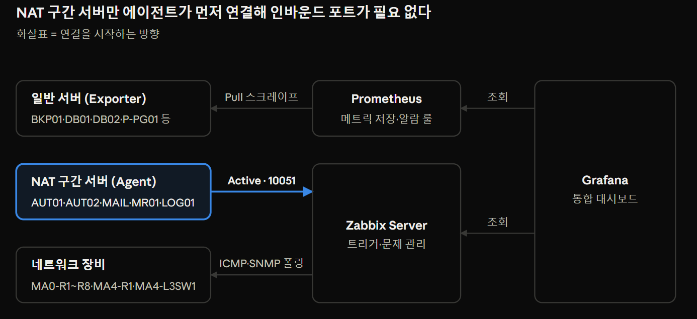
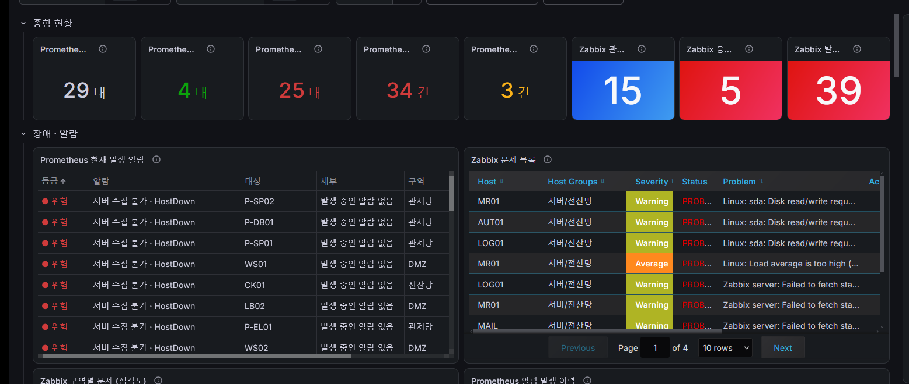
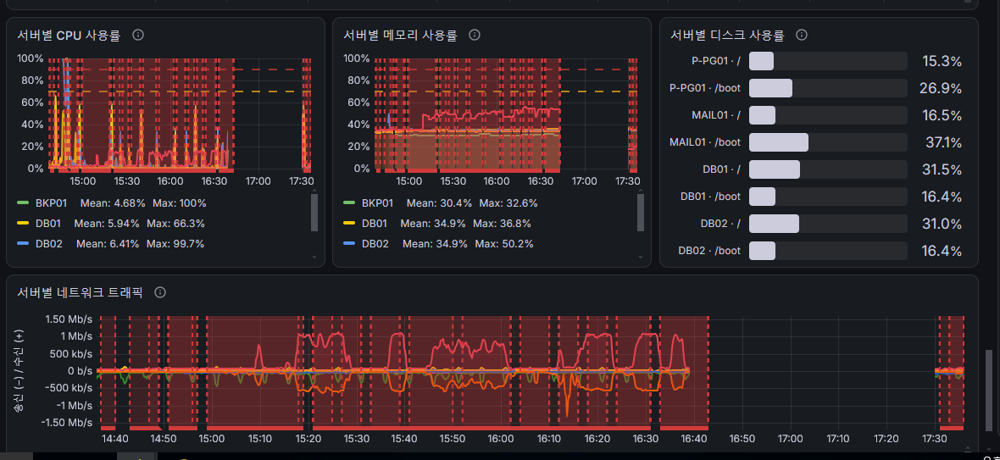
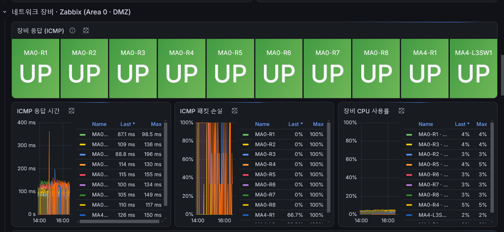
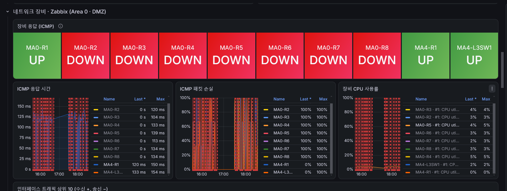

# 대학 IT 인프라 통합 모니터링(NMS) 구축

서버 16대·네트워크 장비 10대의 상태를 **Prometheus·Zabbix**로 수집하고,
**Grafana** 통합 대시보드 한 화면에서 장애와 이상 징후를 실시간 관제한 프로젝트입니다.
(정보보안 전문가 과정 3차 파이널 / 2026.09 ~ 2026.10)

---

## 담당 역할
네트워크·서버·레드(공격)·퍼플(관제) 4개 팀 협업 프로젝트에서 관제팀으로 **관제 구역 내부 망 구성**과 **통합 모니터링(NMS) 구축**을 담당했습니다. 관제팀의 SIEM은 팀장이, 구역 사이의 경계 라우팅과 재분배는 네트워크 담당 팀원이 맡았습니다. 이 저장소는 그중 **모니터링** 부분을 정리한 것입니다.

---

## 1. 무엇을 만들었나
- **관제 목적**: 서비스 가용성 확보, 자원 이상·장애 조기 탐지, 공격으로 인한 영향 범위 확인
- **관제 범위**: 관제망·전산망·DMZ 서버, Area 0·DMZ 라우터 및 L3 스위치
- **한 화면 통합**: Prometheus·Zabbix 수집 데이터를 Grafana 한 곳에 모아 판단

---

## 2. 수집 구조 — 대상에 따라 도구를 나눔

| 대상 | 수집 도구 | 수집 방식 | 선택 이유 |
|---|---|---|---|
| 서버 Metric | **Prometheus** | Exporter Pull (HTTP 스크레이프) | PromQL 기반 알람 룰 적용에 적합 |
| **NAT 뒤 서버** | **Zabbix** | Zabbix Agent **Active 모드** | 아래 ★ |
| 네트워크 장비 | **Zabbix** | ICMP 폴링 + SNMP 폴링 | 장비엔 에이전트 설치 불가 |
| 시각화·통합 | **Grafana** | Prometheus·Zabbix 데이터소스 연동 | 한 화면 관제 |

> ★ **설계 포인트**: Zabbix Agent를 Passive 모드로 두면 서버가 에이전트의 **10050/TCP**로 접속하므로, NAT 구간 서버마다 포트포워딩(인바운드 개방)이 필요해 공격 표면이 늘어납니다. 그래서 **Active 모드**로 구성해 에이전트가 서버의 **10051/TCP**로 먼저 연결(아웃바운드)하게 했고, 인바운드 포트를 열지 않고 NAT 내부 서버를 수집하도록 설계했습니다.

---

## 3. Grafana 통합 대시보드

서버·NAT 구간·네트워크 장비 상태와 현재 발생 알람을 한 화면에서 확인합니다.

| 패널 그룹 | 표시 항목 |
|---|---|
| 종합 현황 | Prometheus 대상 수, Zabbix 관제 호스트 수, 현재 발생 알람 건수 |
| 장애·알람 | Prometheus 알람(등급·대상·구역), Zabbix 문제 목록(Severity·Host Group) |
| 서버 자원 | 서버별 CPU·메모리·디스크 사용률, 네트워크 송수신 트래픽 |
| NAT 구간 서버 | 에이전트 연결 상태, CPU·메모리·디스크 |
| 네트워크 장비 | 장비 ICMP UP/DOWN, 응답 시간, 패킷 손실, 장비 CPU, 인터페이스 트래픽 Top 10 |

### 서버 자원 패널 (80% 임계선 기반 알람)

---

## 4. 알람 규칙 (탐지 → 대응)

| 탐지 항목 | 탐지 방법 | 기준 | 대응 |
|---|---|---|---|
| 서버 수집 불가(HostDown) | Prometheus `up` | `up == 0` | 서버·Exporter 프로세스 확인, 동일 구역 다수 시 네트워크 장애·공격 점검 |
| 서버 CPU 과다 | Prometheus 알람 룰 | 80% 이상 | 상위 프로세스 확인, 비인가 프로세스(마이닝·웹셸) 점검 |
| 서버 트래픽 이상 | Prometheus 알람 룰 | 평시 대비 배수 초과 | 출발지·목적지 확인, IDS/WAF 로그와 대조해 DoS·유출 여부 판단 |
| NAT 서버 에이전트 단절 | Zabbix 에이전트 가용성 | 연결 끊김 | 서버 상태·10051/TCP 경로 확인 |
| 디스크 I/O 과다 | Zabbix 트리거 | read/write 임계 초과 | I/O 유발 프로세스, 대량 파일 쓰기·암호화(랜섬웨어) 점검 |
| 네트워크 장비 다운 | Zabbix ICMP 폴링 | 응답 없음, 패킷 손실 100% | 장비 콘솔·라우팅·이중화 경로 확인 |

---

## 5. 공격 대응 사례 — UDP Flood 시 응답 끊긴 구간 식별

레드팀의 UDP Flood 모의 공격 중, 네트워크 장비 가용성 패널에서 응답이 끊긴 구간을 식별해 네트워크팀에 전파했습니다.

**공격 전 — 전 구간 UP**

**공격 후 — MA0-R2~R8 (7대) DOWN, ICMP 패킷 손실 100%**

- **MA0-R1, MA4-R1, MA4-L3SW1은 UP 유지** → 관제 서버 기준 도달 불가 구간을 **MA0-R2~R8로 좁혀** 네트워크팀에 전파
- ICMP 손실 100%는 관제 서버에서 해당 장비까지 응답이 오지 않는다는 뜻입니다. 장비 자체 장애인지 관제 경로의 단절·포화인지는 ICMP만으로 구분할 수 없어, 네트워크팀이 해당 라우터를 직접 확인해 조치했습니다.
- 알람 확인에서 끝내지 않고, IDS/WAF 탐지 시점과 자원·가용성 지표 변화를 교차 대조해 **일반 장애인지 공격 피해인지** 판단하는 흐름까지 구성했습니다.

---

## 6. 운영 자동화
- Zabbix·Grafana 설치 자동화 코드를 AI를 활용해 작성 (이를 **Ansible**로 통합해 장비·서버 설정과 수집 에이전트 배포를 자동화한 작업은 다른 팀원 담당)
- NTP(chrony)로 전 서버 시각 동기화 → 로그·증적 시각 정렬

---

## 7. 트러블슈팅 — 이중화 직후 수집 중단, 원복으로 관제 복구
가용성을 높이려고 관제 서버와 링크를 이중화한 직후, Grafana에서 수집 데이터 전송 속도가 **3.4MB/s → 3.1KB/s**(약 1/1000)로 떨어진 것을 발견했습니다. 수집이 사실상 멈춘 상태였고, 관제 화면이 끊긴 동안에는 장애가 나도 알 수 없다고 판단했습니다.

| 단계 | 내용 |
|---|---|
| 탐지 | 이중화 직후 수집 속도 3.4MB/s → 3.1KB/s, 대시보드 끊김 |
| 초동 조치 | 원인 분석보다 관제 복구를 우선해, 관제 서버 네트워크를 이중화 이전 구조로 원복 |
| 결과 | 수집 1.4~2.1MB/s로 재개, 대시보드 끊김 해소 |
| 원인 | **미규명.** 이중화 직후 발생해 이중화 구성을 원인으로 추정 |
| 남은 과제 | 원인 후보(비대칭 경로, 본딩·LACP 설정 불일치, ARP/MAC 플래핑 등, 미검증)를 재현 환경에서 확인하고, 원복 후 수집량이 이전(3.4MB/s)보다 낮은 이유 확인 |

→ 운영 중인 구성을 바꿀 때는 영향 범위를 먼저 검토하고 되돌릴 방법을 준비해 두어야 한다는 것을 배웠습니다.

---

## 8. 사용 기술
`Prometheus` `Zabbix` `Grafana` `Alertmanager` `node_exporter` `SNMP` `Linux(Rocky/Ubuntu)` `OSPF` `VLAN` `NAT`
